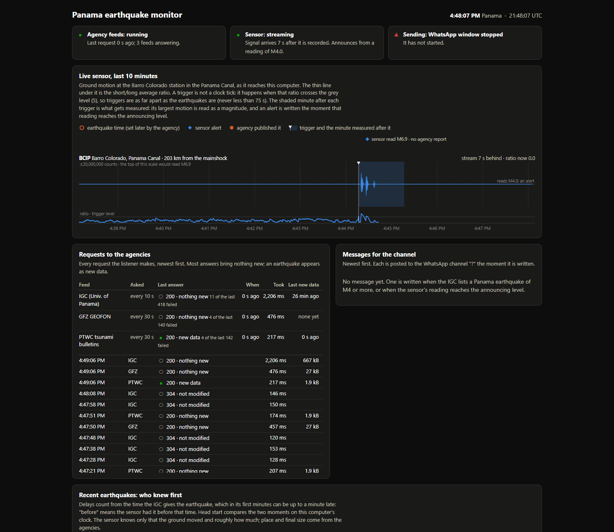
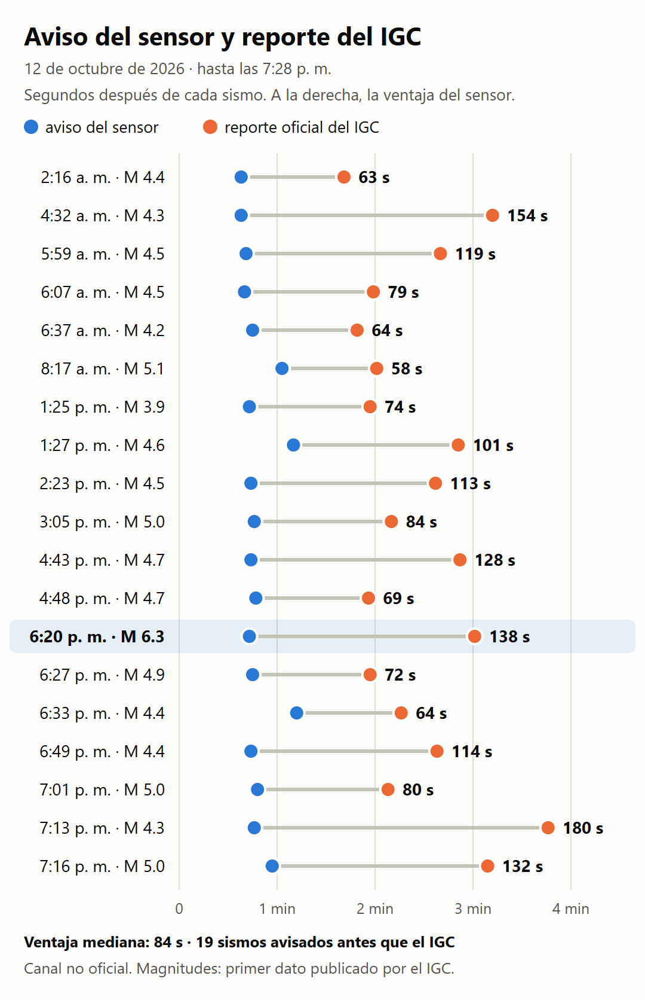
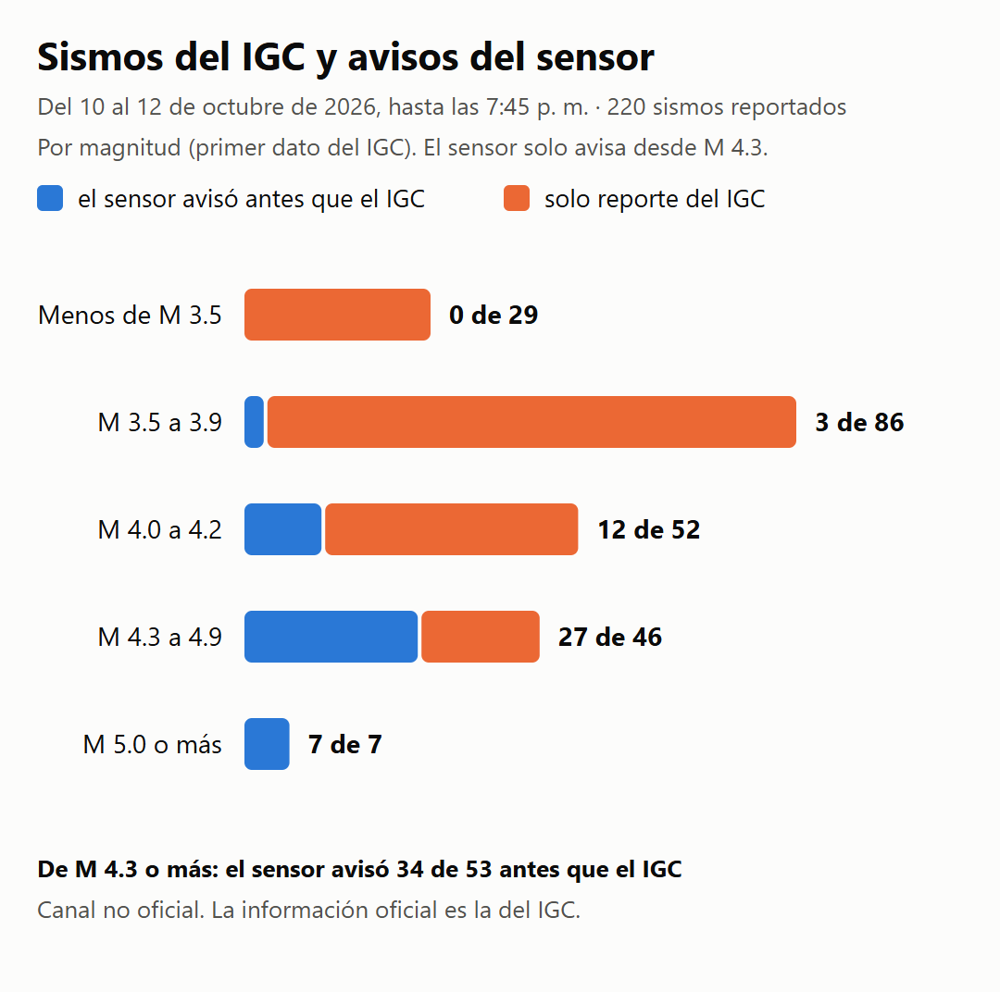
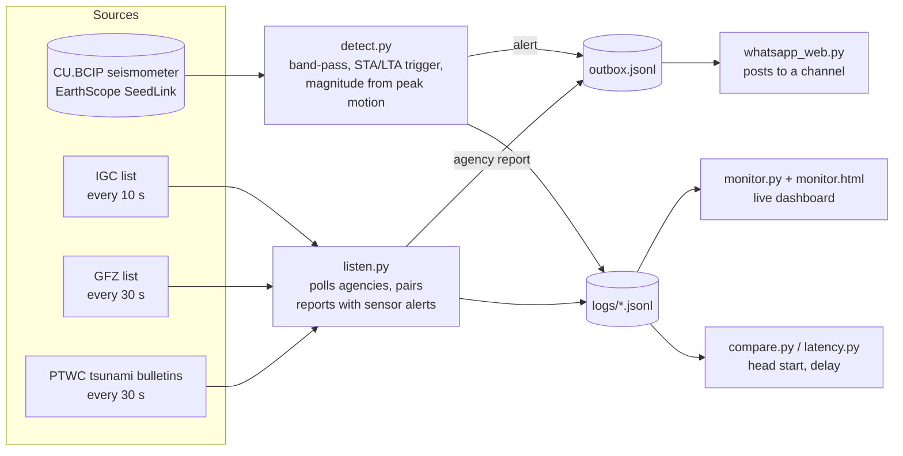
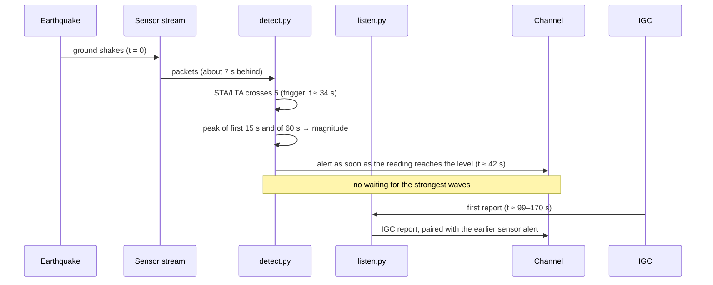
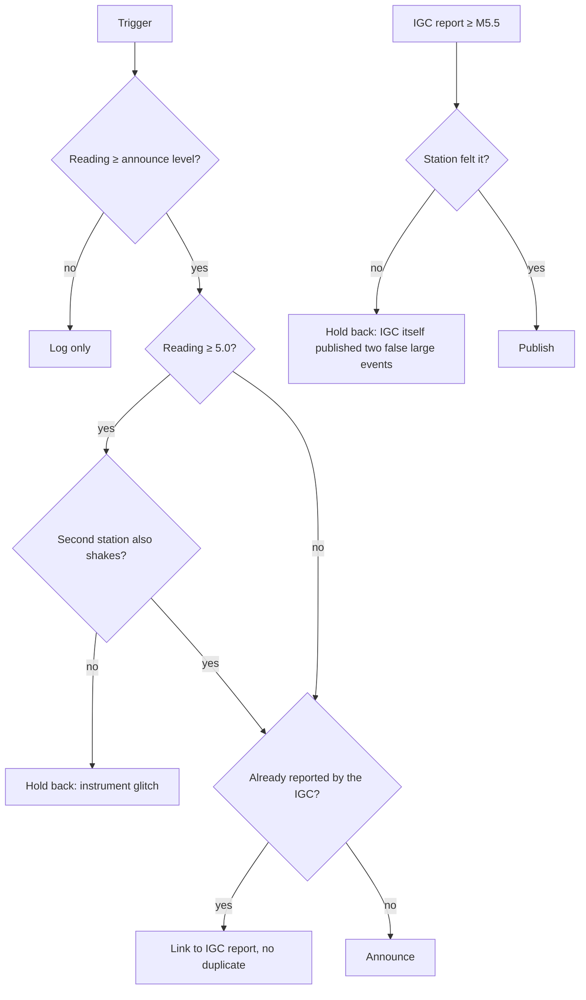
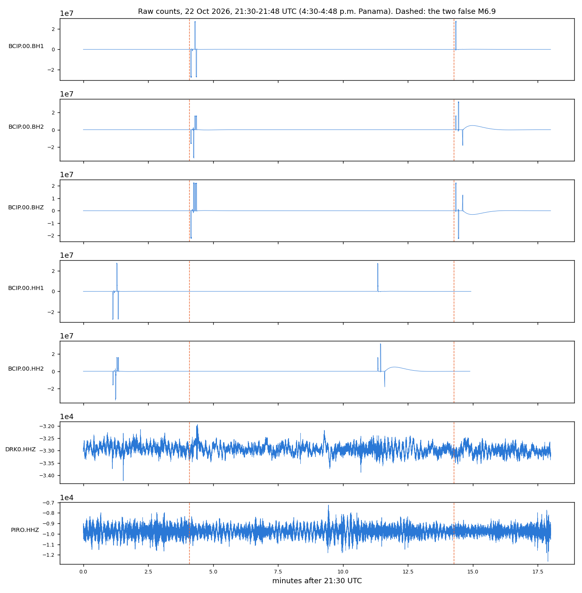

# Panama Quake Alert

A real-time earthquake alert prototype built after the **M7.7 Azuero earthquake in Panama (2026-10-09)**.
It reads one public seismometer, detects shaking before any agency has published the earthquake, estimates
the magnitude, and posts an alert a median **42 seconds** after the earthquake, about **74 seconds before**
Panama's official institute (IGC, Universidad de Panama).

> **Unofficial, experimental, not a safety system.** Official information comes from the IGC. This project was
> an engineering experiment to see how fast one open sensor and a few lines of code can be.



*The monitor page: sensor signal with the short/long-average ratio (bottom line) and the 60 s measured after
each trigger, agency requests, and who knew first. The window shown contains a real instrument glitch
(2026-10-22) that read M6.9: it led to the second-station check described below.*

## Results

All numbers come from the project's own logs (Oct 10 to Oct 22, 2026). Reference: the IGC's first published
magnitude and time for each earthquake.

| Measure | Result |
|---|---|
| Alert delay after the earthquake (live, median) | **42 s** (44 s in a 78 h replay of the same code) |
| Head start over the IGC (median, n = 42) | **74 s** (mean 86 s) |
| Largest event, M6.3 near Coiba (Oct 12) | alert **43 s** after, **138 s before** the IGC |
| Magnitude vs the IGC's first figure (140 pairs) | bias -0.03, MAE **0.24**, **93 %** within 0.5 |
| Station coverage (CU.BCIP vs IGC M4.5+) | **93 of 98** earthquakes seen (other two stations: 69 and 79) |
| Replay, 78 h | 34 of 40 IGC M5+ earthquakes announced; 0 alerts on two ordinary days |
| IGC first report delay | 99 to 170 s after the earthquake (median 118 s) |




## How it works



### One alert, step by step



### Guards added after live failures



## The maths

**Filter.** The vertical component is band-passed at 1 to 8 Hz (4th-order Butterworth, causal): nearby
earthquakes are strong there and distant ones weak.

**Trigger (recursive STA/LTA).** With `x_n` the filtered signal, `N_s = 1.5 s` and `N_l = 30 s` (in samples):

$$
\mathrm{STA}_n = \mathrm{STA}_{n-1} + \frac{x_n^2 - \mathrm{STA}_{n-1}}{N_s}, \qquad
\mathrm{LTA}_n = \mathrm{LTA}_{n-1} + \frac{x_n^2 - \mathrm{LTA}_{n-1}}{N_l}, \qquad
r_n = \frac{\mathrm{STA}_n}{\mathrm{LTA}_n}
$$

A trigger starts when `r_n ≥ 5` and ends at `r_n ≤ 1.5`; after a trigger no new one starts for 75 s (the same
earthquake's later waves).

**Magnitude.** The largest absolute motion `P` (in counts) after the trigger is turned into a magnitude with
a line fitted on 143 IGC magnitudes of the Azuero sequence:

$$
M = a \log_{10}(P) + b
$$

| Reading | Window | a | b | Typical error |
|---|---|---|---|---|
| Whole wave | 60 s | 0.9093 | 0.2787 | ±0.25 |
| First wave only | 15 s | 0.9357 | 0.3145 | ±0.30 |

The alert fires the moment either reading reaches the announcing level, so it does not wait for the strongest
waves (about 25 s after the first one at this distance). An update can be sent if the reading later grows by 0.5 (`send_updates` in the config).

**Head start.** For each earthquake, `Δt = t_IGC_published − t_sensor_alert`, both on the same computer's
clock (corrected against network time). Positive means the sensor was first.

## Limits (measured, not hidden)

- **One station, no location.** It knows that the ground moved and roughly how much; place and final size come
  from the agencies. The magnitude line is valid for earthquakes about as far as Azuero (around 200 km).
- **Large earthquakes read low at first** and are updated when the reading grows.
- **Instrument glitches.** On 2026-10-22 the station produced two false M6.9 readings (raw spikes in all
  channels, below). The second-station check (DRK0, PIRO) was added and tested on the archive: both glitches
  are held back, while the real M6.3 and an M5.7 still go out 8 to 20 s later.
- **The IGC also errs.** It published two false large earthquakes (M7.2 and M6.2, later deleted), so IGC reports of
  M5.5 or more are held back unless the station felt them.
- Only two quiet days were tested for false alarms; the station coverage figures come from one sequence.
- `whatsapp_web.py` drives WhatsApp Web with a browser. WhatsApp's terms do not allow automation and the number
  can be restricted; use the Telegram or API options in `config.example.json` for anything serious.



## Run it

```bash
pip install -r requirements.txt
cp src/config.example.json src/config.json      # fill in your own destination; never commit it
python src/detect.py --minutes 35               # sensor only, logs to src/logs/
python src/listen.py                            # agency feeds (needs a destination in config.json)
python src/monitor.py                           # dashboard at http://127.0.0.1:8791 (reads the logs only)
python src/compare.py                           # head start of the sensor over the IGC
python tests/glitch_test.py                     # replays the Oct 22 glitch on EarthScope's archive
```

`monitor.py --start` also starts and supervises the other programs. Nothing is sent anywhere unless a
destination is configured.

## Layout

```
src/detect.py          live detector (SeedLink, STA/LTA, magnitude, alerts)
src/detector_core.py   filter, trigger, magnitude: shared by live code, replay and calibration
src/listen.py          IGC / GFZ / PTWC polling, pairing, message text, idempotent restarts
src/calibrate.py       fits calibration.json against the IGC list; --compare ranks candidate stations
src/replay.py          runs the live code over recordings
src/compare.py         head start and delay measurements from the logs
src/monitor.py/.html   local dashboard
src/whatsapp_web.py    channel posting through a browser (see limits)
tests/                 guard, forward, glitch and message tests; a stand-in page that behaves like a channel
```

## Data and credits

Seismic data: CU network station BCIP via EarthScope SeedLink. Earthquake lists: Instituto de Geociencias,
Universidad de Panama (IGC), GFZ GEOFON. Tsunami bulletins: NOAA PTWC. Libraries: ObsPy, NumPy, Playwright.

Author: Luis Hoi Fan. MIT license.
